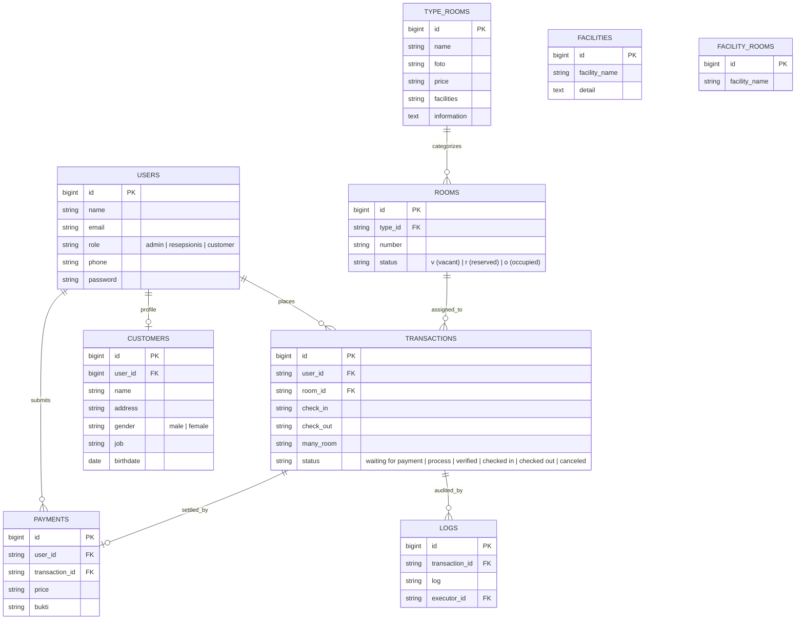
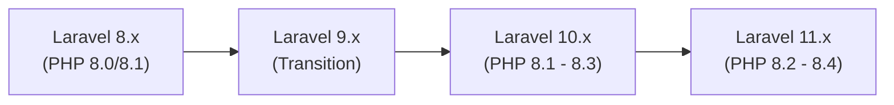

<div align="center">

# 🏨 Hotel Hebat - Web Application

**An intuitive, full-featured Hotel Management & Reservation System built on the Laravel framework.**

[](https://laravel.com)
[](https://php.net)
[](https://getbootstrap.com)
[](LICENSE)
[](https://github.com/fauzanlm/laravel-hotel-web-app/actions)

<p align="center">
  <a href="#-about-the-project">About</a> •
  <a href="#-key-features">Key Features</a> •
  <a href="#-user-roles--demo-credentials">Demo Credentials</a> •
  <a href="#-database-schema--erd">Database Schema</a> •
  <a href="#-system-requirements">Requirements</a> •
  <a href="#-installation-guide">Installation</a> •
  <a href="#-modernization--upgrade-roadmap">Modernization Roadmap</a>
</p>

</div>

---

## 📖 About the Project

**Hotel Hebat** is an end-to-end hotel reservation and administration web portal designed to deliver a smooth guest experience from room browsing to invoice generation, while providing staff and managers with complete oversight of rooms, transactions, and check-ins.

Built using Laravel with multi-tier role-based access control (RBAC), the system streamlines daily hospitality workflows for guests, receptionists, and administrators.

---

## ✨ Key Features

### 👤 Guest / Customer
- **Room Catalog & Details:** Browse rooms categorized by types with real-time price, facility tags, and photo galleries.
- **Online Booking:** Select check-in & check-out dates, guest counts, and room quantity with instant room allocation.
- **Payment Verification:** Upload payment receipts/proofs directly into the portal.
- **Digital Invoices & Tickets:** Download or print PDF booking confirmations with integrated QR codes for rapid front-desk verification (`barryvdh/laravel-dompdf` + `simplesoftwareio/simple-qrcode`).
- **Booking Management:** Track active reservation statuses and cancel pending reservations before confirmation.

### 🛎️ Front Desk / Receptionist
- **Reservation Processing:** Inspect incoming bookings, filter by date/guest, and transition orders through status stages (`Process`, `Verified`, `Failed`, `Rejected`).
- **Streamlined Check-In & Check-Out:**
  - One-click check-in for pre-booked guests.
  - Direct walk-in personal data check-in (`checkin-pdata`).
  - Automated room occupancy state toggle (`Vacant` ➔ `Occupied` ➔ `Vacant`).
- **Payment Reconciliation:** Review and approve customer-uploaded payment receipts or upload manual proofs on the spot.
- **Activity Logbook:** Transparent audit trail of check-ins, check-outs, and order status updates.

### 🛡️ Admin Management
- **Dashboard Overview:** Real-time visibility into overall bookings, room occupancy, and revenue streams.
- **Room Management:** CRUD operations for individual hotel room numbers, types, and operational states.
- **Room Types & Pricing:** Configure room categories, amenities, pricing per night, and gallery photos.
- **Facility Management:** Maintain hotel-wide amenities (swimming pool, restaurant, gym, Wi-Fi) and in-room facilities.
- **System Audit Logs:** Full event logging of operational executions with timestamp and executor IDs.

---

## 📸 Screenshots

<div align="center">
  <table>
    <tr>
      <td align="center"><b>Landing Page & Hero</b></td>
      <td align="center"><b>Room Selection & Details</b></td>
    </tr>
    <tr>
      <td></td>
      <td></td>
    </tr>
    <tr>
      <td align="center"><b>Admin Dashboard</b></td>
      <td align="center"><b>Receptionist Management</b></td>
    </tr>
    <tr>
      <td></td>
      <td></td>
    </tr>
    <tr>
      <td align="center"><b>Booking & Reservation</b></td>
      <td align="center"><b>Payment & Invoice Ticket</b></td>
    </tr>
    <tr>
      <td></td>
      <td></td>
    </tr>
  </table>
  <br>
  
</div>

---

## 👥 User Roles & Demo Credentials

When the database seeders are executed (`php artisan db:seed`), the following test accounts are automatically provisioned:

| Role | Name | Email | Password | Dashboard URL | Capabilities |
| :--- | :--- | :--- | :--- | :--- | :--- |
| **Admin** | Hamba Allah | `adminhh@gmail.com` | `hhebatadmin` | `/admin` | Rooms, Room Types, Hotel Facilities, Room Facilities, System Logs |
| **Receptionist** | Receptionis | `receptionis@gmail.com` | `hhebatreceptionis` | `/receptionis` | Reservation verification, Check-In, Check-Out, Upload payment proofs |
| **Customer** | Daniel | `daniel14@gmail.com` | `danielqwe` | `/transactions` | Booking rooms, payment proof upload, print PDF tickets |
| **Customer** | Muhammad Fauzan | `fauzan14072004@gmail.com` | `mfau1407` | `/transactions` | Booking rooms, payment proof upload, print PDF tickets |

---

## 🗄️ Database Schema & ERD

### Entity-Relationship Diagram



### Room & Transaction Lifecycle States
- **Room Statuses:**
  - `v` (**Vacant / Available**): Ready to be booked.
  - `r` (**Reserved**): Blocked by an active booking.
  - `o` (**Occupied**): Guest has completed check-in.
- **Transaction Statuses:**
  `waiting for payment` ➔ `process` ➔ `verified` ➔ `checked in` ➔ `checked out` *(or `canceled`, `failed`, `rejected`)*.

---

## 💻 System Requirements

- **PHP:** `>= 8.0` (compatible with PHP 8.0 and 8.1)
- **Composer:** `>= 2.0`
- **Node.js & NPM:** Node.js `>= 16.x` & NPM `>= 8.x`
- **Database:** MySQL `>= 5.7` / MariaDB `>= 10.3` or SQLite `>= 3.8`
- **PHP Extensions:** `pdo_mysql`, `mbstring`, `openssl`, `tokenizer`, `xml`, `ctype`, `json`, `gd` (for QR Code generation)

---

## 🚀 Installation Guide

### Step 1: Clone the Repository
```bash
git clone https://github.com/fauzanlm/laravel-hotel-web-app.git
cd laravel-hotel-web-app
```

### Step 2: Install Dependencies
```bash
# Install PHP Composer dependencies
composer install

# Install Frontend NPM dependencies
npm install
```

### Step 3: Configure Environment
```bash
# Copy example environment configuration
cp .env.example .env

# Generate application encryption key
php artisan key:generate
```

### Step 4: Configure Database
Open `.env` in your preferred editor and set your database connection details:
```env
DB_CONNECTION=mysql
DB_HOST=127.0.0.1
DB_PORT=3306
DB_DATABASE=laravel_hotel
DB_USERNAME=root
DB_PASSWORD=
```
*(Optional: For quick testing with SQLite, set `DB_CONNECTION=sqlite` and create an empty file: `touch database/database.sqlite`)*

### Step 5: Run Migrations and Seeders
```bash
# Run schema migrations and populate demo accounts & rooms
php artisan migrate --seed
```

### Step 6: Link Storage Directory
Ensure public access to uploaded photos and payment proofs:
```bash
php artisan storage:link
```

### Step 7: Compile Assets & Run Local Server
```bash
# Compile frontend assets
npm run dev

# Start local PHP server
php artisan serve
```

Access the application in your browser:
👉 **http://127.0.0.1:8000**

---

## 🧪 Testing & Continuous Integration

This repository includes a production-ready CI workflow template located at [`.github/workflows.example/tests.yml`](.github/workflows.example/tests.yml):

- **Composer Lock & Spec Validation**: `composer validate --strict`
- **PHP Syntax & Linting**: Syntax inspection across all controllers, models, routes, migrations, and configs.
- **Unit & Feature Tests**: Execution of PHPUnit suites using SQLite in-memory database.

### Enabling GitHub Actions CI
To activate GitHub Actions in your repository fork or origin:
```bash
# 1. Enable workflow scope if using GitHub CLI
gh auth refresh -s workflow

# 2. Activate the workflow template
mkdir -p .github/workflows
cp .github/workflows.example/tests.yml .github/workflows/tests.yml
git add .github/workflows/tests.yml
git commit -m "ci: activate GitHub Actions workflow"
git push
```

Run the test suite locally:
```bash
vendor/bin/phpunit
# or
php artisan test
```

---

## 🏗️ Modernization & Upgrade Roadmap

The project is currently running **Laravel 8.75**. To modernize the codebase towards **Laravel 10** or **Laravel 11**, the following breaking changes and dependency replacements should be applied:



### Key Migration Checklist

| Component / Package | Current (v8) | Target (v10 / v11) | Notes & Actions |
| :--- | :--- | :--- | :--- |
| **PHP Runtime** | `^7.3 \| ^8.0` | `^8.2 \| ^8.3` | Upgrade hosting environment to PHP 8.2+. |
| **`laravel/framework`** | `^8.75` | `^10.0` or `^11.0` | Follow Laravel Upgrade Guide for method return types. |
| **`fruitcake/laravel-cors`** | `^2.0` | *Removed* | Laravel 9+ has built-in CORS middleware (`Illuminate\Http\Middleware\HandleCors`). |
| **`facade/ignition`** | `^2.5` | `spatie/laravel-ignition: ^2.0` | `facade/ignition` is discontinued for Laravel 9+. |
| **`barryvdh/laravel-dompdf`** | `^1.0` | `^2.0` | Update namespace calls if using deprecated methods. |
| **`laravel/sanctum`** | `^2.11` | `^3.2` (v10) / `^4.0` (v11) | Review PersonalAccessToken tokenable relation types. |
| **`laravel/ui`** | `^3.4` | `^4.2` | Retains Bootstrap 5 auth scaffolding on newer Laravel. |
| **Build Tooling** | `laravel-mix` (Webpack) | `vite` + `@vitejs/plugin-vue` | Migrate from `webpack.mix.js` to `vite.config.js` for blazing-fast HMR. |
| **Model Casts** | `$casts` array property | `casts(): array` method | Modern Laravel 11 idiomatic model attribute casting. |

---

## 📄 License

This software is open-sourced under the [MIT License](LICENSE).

## 👨‍💻 Author

- **Muhammad Fauzan** ([@fauzanlm](https://github.com/fauzanlm))
